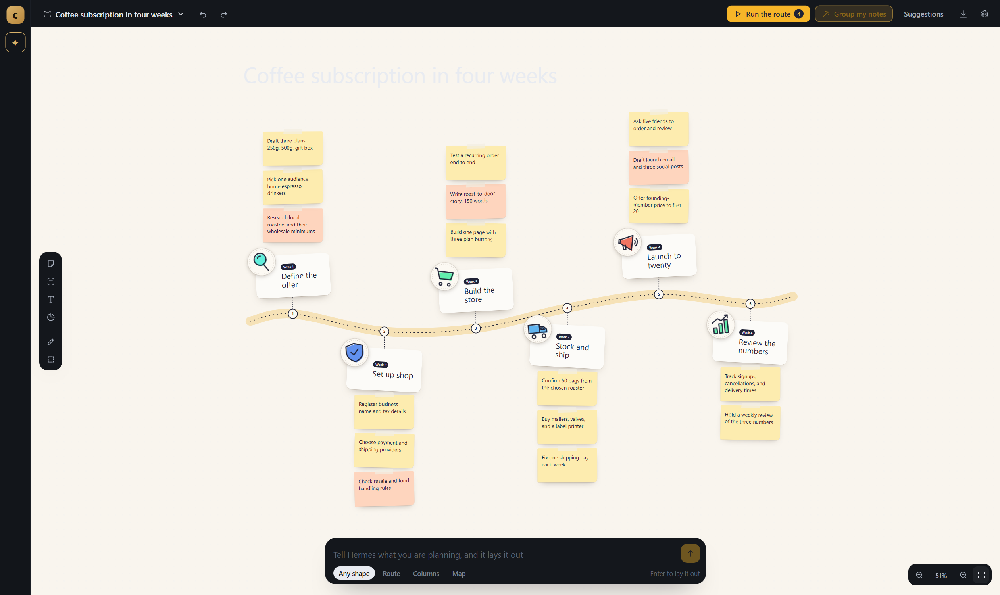

# Throughline

**A board that runs your plan.** Jot a sentence, watch it become a route of stops, notes and action
items — then hand any item to a coding agent that does the work and puts the result back on the board.



One process serves three things: a board, an agent console, and an agent-agnostic API. The agents are
interchangeable because they all speak **ACP** — Claude Code, Codex, OpenCode and Hermes are peer
implementations, not integrations to maintain one by one.

## How it fits together

| Piece | What it does |
|---|---|
| **Engine** (`packages/acp-host`) | Spawns ACP agents, keeps one session per board, and exposes them twice: AG-UI for workspaces, and the board's own RPC + event lane |
| **Board host** (`packages/board-host`) | The small, fixed surface a board module is written against — atoms, host verbs, icons, three UI areas |
| **App** (`packages/app`) | Loads a board module, gives it storage, the engine's lanes and an OS facade, and renders what it registers |

Agents are data. A new coworker is one entry in `packages/acp-host/agents.json`:

```json
{ "id": "opencode", "label": "OpenCode", "command": "opencode", "args": ["acp"], "cwd": "." }
```

## Quick start

```sh
git clone https://github.com/Nilabh-code/throughline.git
cd throughline

# engine
cd packages/acp-host && npm install && cd ../..

# app (React + Vite)
cd packages/app && npm install && cd ../..

# build the board UI, then start everything
npm --prefix packages/app run build
node scripts/up.mjs
```

| URL | What |
|---|---|
| `http://127.0.0.1:8790/board/` | the board |
| `http://127.0.0.1:8790/` | agent console — prompt any agent directly |
| `http://127.0.0.1:8790/agents` | coworkers and their AG-UI endpoints |

`scripts/up.mjs` starts the database (if you run one) and the engine, and prints those URLs. It is
idempotent. Stop everything with the `down` counterpart once it exists.

## Bring your own board module

The board page is not vendored here. Throughline hosts **any** ES module that exports:

```js
export default {
  id: 'board',
  name: 'Board',
  register(ctx) {
    ctx.registerMany([
      { id: 'page', area: ROUTES_AREA, title: 'Board', data: { path: '/board' }, render: () => <Page /> },
      { id: 'nav',  area: SIDEBAR_NAV_AREA, data: { label: 'Board', path: '/board' } }
    ])
  }
}
```

| It asks for | You get |
|---|---|
| `ctx.storage.get/set/remove` | synchronous key/value storage |
| `ctx.rest(path, {method, body})` | the engine's boards, sharing and inbox lane |
| `ctx.os.openExternal / writeClipboard / pickSavePath` | a browser-safe OS facade |
| `ctx.onDispose(fn)` / `ctx.registerMany([...])` | lifecycle and UI registration |
| `host.request(method, params)` | JSON-RPC into the engine (`session.create`, `prompt.submit`, `session.interrupt`, `approval.*`, `agent.*`) |
| `host.onEvent(name, fn)` | streamed `message.complete`, `tool.start`, `error` — each with a `payload` |
| `useValue(atom)`, `icons`, `Tip`, `Streamdown` | rendering primitives |

Point the build at your module:

```sh
BOARD_MODULE=/path/to/board.js npm --prefix packages/app run build
# or drop it at vendored/board/plugin.js
```

## Sessions

One conversation per board. The board's active id travels with every RPC, so commands on the same
board build on each other, a new board starts a new conversation, and `session.reset` starts over
without leaving the board.

## Controls

| Input | Does |
|---|---|
| wheel | zoom (~15% per notch, around the pointer) |
| shift + wheel | pan |
| double-click / N | new note |
| P / L | pen / select area |
| agent picker (left rail) | which ACP agent does the work |

## Tests

Three headless suites drive the real page — no mocks:

```sh
cd packages/app
node scripts/journey.mjs      # create → select → zoom → persist → delete   (14 assertions)
node scripts/interact.mjs     # hover, pan, keys, every toolbar button, tree-alive after each
node scripts/session-check.mjs  # one session per board, new board → new session
```

## Design notes

- **Agents are processes, not plugins.** Nothing in the engine branches on which agent is running.
- **The board module is a guest.** It gets a contract; the host owns storage, networking and chrome.
- **Failures name the layer.** A transport error, a spawn error and a model-config error are reported
  as different things, because they are.
- **No hidden state.** Boards, sessions and agent processes are inspectable in `/health`.

## Conventions

- Commits are authored as **Nilabh Yadav <agrobothex@gmail.com>**.
- `main` always runs: build + the three suites above before a merge.
- One feature per branch, squash on merge, no generated files committed.

## License

MIT © Nilabh Yadav — see [LICENSE](LICENSE).
